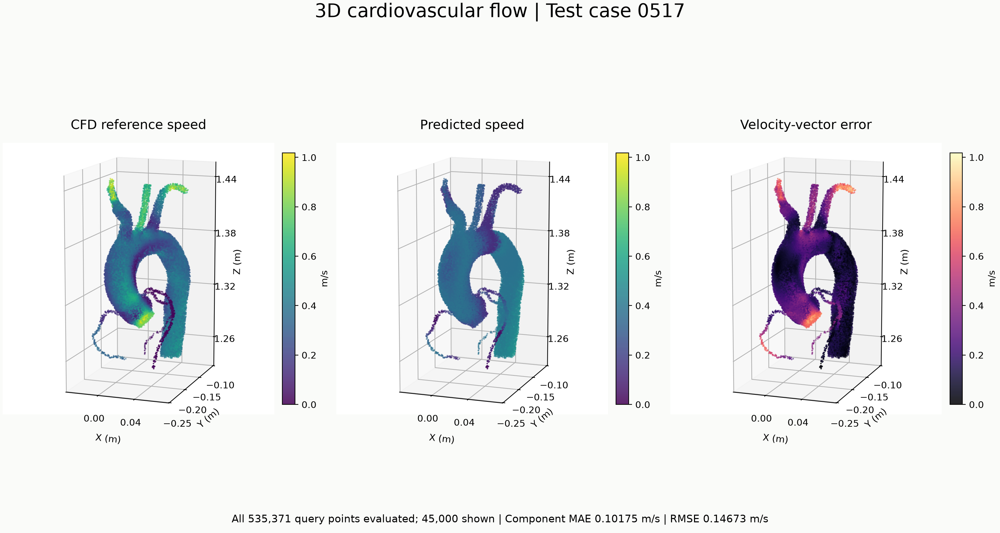

# 3D Cardiovascular Flow — Result Viewer

A compact visualization of a pretrained point-cloud network on cardiovascular test case **0517**. Compare the CFD reference, predicted velocity magnitude, and velocity-vector error.

**[Open the result viewer](https://siruiwang-615.github.io/cardiovascular-flow-demo/)**



## Result

| Item | Value |
|---|---:|
| Geometry points | 55,935 |
| Evaluated query points | 535,371 |
| Points displayed | 45,000 (fixed random seed 42) |
| Velocity-component MAE | 0.101749 m/s |
| Velocity-component RMSE | 0.146733 m/s |

Reference and predicted speed share one color scale in m/s. Error is the Euclidean norm of the three-component prediction error and has its own color scale. The metrics use **all query points**, not just the plotted sample. Branches show visible discrepancies; this is a single-case demonstration, not a claim of generalization accuracy or clinical validation.

## Provenance and implementation

The supplied archive `3D - test.rar` contains `model.py`, `iter_model.h5`, and the `0517` geometry/reference CSV pair. This demo loads that existing checkpoint; it does not claim the original model architecture or training as new work. The supplied network code matches the Python source files in the [ACS research supplement](https://doi.org/10.1021/acsami.2c17198.s002); the related cardiovascular work provides a [public code archive](https://doi.org/10.5281/zenodo.4287103). This file match alone does not establish that the checkpoint belongs to the 2023 carotid study.

This repository adds a NumPy inference implementation of the supplied dense-layer/PointNet forward pass, corrected MAE/RMSE calculation, shared-scale visualization, and a lightweight result page. **Inference has not been cross-validated against the original TensorFlow runtime.** The image is the unedited prediction result.

## Reproduce locally

The raw data and checkpoint are **not included**. With your authorized copy of the archive:

```sh
python -m pip install -r requirements.txt
python reproduce.py --input '/path/to/3D - test' --output results
```

The script reads the HDF5 checkpoint and CSV files directly. No pickle files are executed or loaded. It writes the comparison image and metrics. Python 3.12 was used for the displayed result.

To view the static page locally:

```sh
python -m http.server 8000
```

Open http://localhost:8000. The page is buildless and uses no analytics or backend.

## Scope

This repository publishes a result figure and visualization/reproduction code only. Original third-party code, checkpoint, and raw medical geometry are not redistributed. The original research materials retain their own terms; no blanket license is asserted over them.
